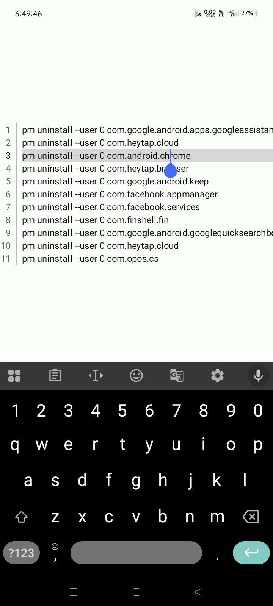
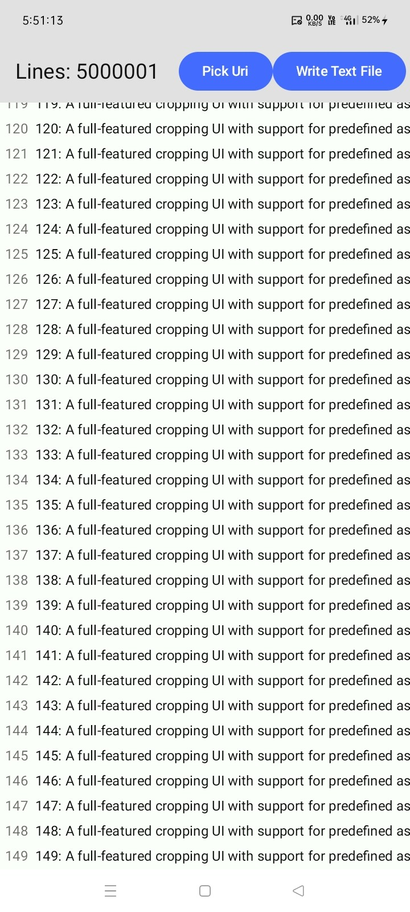
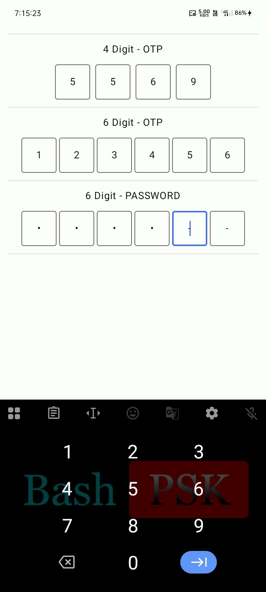

# 📝 Text Editor & Viewer

[](https://jitpack.io/#com.github.bashpsk.emptylibs/text-editor)
[](https://opensource.org/licenses/Apache-2.0)

A high-performance text editor and lazy text viewing library for Jetpack Compose, capable of
rendering large files (millions of lines) efficiently without OutOfMemory errors.

---

## ✨ Features

- **BasicTextEditor**: Line-numbered text field wrapper with line highlighting and
  horizontal/vertical scrolling support for code or plain text.
- **LazyTextViewer**: High-performance text viewer using `LazyColumn` and sparse pointer-based
  random file access to view massive logs or text files lazily.
- **SegmentTextField**: Segmented text field component designed for OTP (One-Time Password), PINs,
  or chunked character inputs with automatic focus traversal, backspace navigation, and custom
  visual transformations.

---

## 📦 Installation

### Groovy (`build.gradle`)

```groovy
dependencies {
    implementation 'com.github.bashpsk.emptylibs:text-editor:VERSION'
}
```

### Kotlin DSL (`build.gradle.kts`)

```kotlin
dependencies {
    implementation("com.github.bashpsk.emptylibs:text-editor:VERSION")
}
```

### Kotlin DSL (`build.gradle.kts`) + Version Catalog (`libs.versions.toml`)

```toml
[versions]
empty-libs = "VERSION"

[libraries]
emptylibs-text-editor = { group = "com.github.bashpsk.emptylibs", name = "text-editor", version.ref = "empty-libs" }
```

```kotlin
dependencies {
    implementation(libs.emptylibs.text.editor)
}
```

---

## 🛠️ Usage

### 📄 Lazy Text Viewer

High-performance viewer capable of rendering millions of lines efficiently.

```kotlin
val state = rememberLazyTextViewerState(
    source = TextSource.Path("/sdcard/large_log.txt")
)

LazyTextViewer(
    modifier = Modifier.fillMaxSize(),
    state = state
)
```

### ✏️ Basic Text Editor

Simple editor with line numbers and standard text field features.

```kotlin
BasicTextEditor(
    modifier = Modifier.fillMaxSize(),
    inputContent = myCodeString,
    onContentChange = { myCodeString = it }
)
```

### 🔢 Segment Text Field

Segmented text field for OTP, PIN, or multi-character entry with automatic focus progression and
backspace handling.

```kotlin
var otpValues by remember {
    mutableStateOf<PersistentList<Char?>>(List(4) { null }.toPersistentList())
}

SegmentTextField(
    modifier = Modifier.fillMaxWidth(),
    value = otpValues,
    onValueChange = { otpValues = it },
    keyboardOptions = KeyboardOptions(keyboardType = KeyboardType.Number),
    horizontalArrangement = Arrangement.spacedBy(8.dp, Alignment.CenterHorizontally)
)
```

---

## 📸 Screenshots

| Basic Text Editor                                                  | Lazy Text Viewer                                                  | Segmented Text Field                                                |
|--------------------------------------------------------------------|-------------------------------------------------------------------|---------------------------------------------------------------------|
|  |  |  |

https://github.com/user-attachments/assets/5a6ab890-8bae-4e07-8c72-22a2c6ea8729

https://github.com/user-attachments/assets/4eebdcd5-ea75-4cba-b72e-9829d569da5e

https://github.com/user-attachments/assets/3d400008-3735-4da9-99fc-3d79855ffb26
